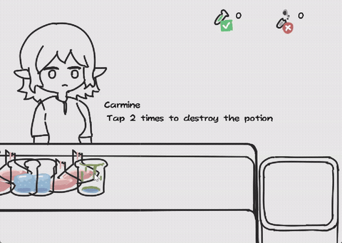

# Potion Inspector

a game for [Autumn Lisp Game Jam 2026](https://heritonaru.itch.io/potion-inspector)



## setup dev env

in windows
```sh
# this will download sdl shared libs from github releases on ../.libs/
bb prep
```

in [steamrt4 SDK](https://gitlab.steamos.cloud/steamrt/steamrt4/sdk/-/blob/steamrt/steamrt4/README.md)
```sh
distrobox create -i registry.gitlab.steamos.cloud/steamrt/steamrt4/sdk steamrt4
distrobox enter steamrt4

# or any other methods listed in above doc
```

## lein-jank

```sh
lein repl

lein with-profile +release compile
```

## build

need jank, babashka
```sh
# download sdl, prep devtime goodies (still hardcoded for windows)
bb prep

# run the game
bb jank

# run the game and the repl
bb repl-dev

# AOT compile
bb compile

# run the compiled game
bb lets play

# AOT compile enabling profiling for Windows Performance Recorder
bb compile :profile?

# ship
bb lets ship
```

## profiling

```sh
bb compile :profile?

./target/potion-inspector---profile.exe

(need separate admin cmd)
wpr -start CPU

# play the game

wpr -stop jank.etl

```
open jank.etl with [Profiler Explorer](https://github.com/microsoft/profile-explorer)

## exp

woes - rewritten
1. What I assumed to be the JIT compilation stutter during a running game had me encounter bug that I think can only be found in jank repl. this could be a longer story, a bug that I name, The Delta Bug (commitid: bdc751636b2abfa99b0ab9e79f2887b3ad4265a2, original woes No. 5)
2. I encountered [bug-1](https://github.com/keychera/bugg-jank/blob/main/src/bermain/bug1.jank): having a binding name the same as a cpp type lead to codegen error. (original woes No. 10)
3. 

woes
1. the virus (It Works On My Machine™)
2. the 3 missing dlls (It Works On My Machine™)
3. the multithreaded texture load (It Works On My Machine™)
4. the GC Pressure perf drop (might or might not be odoyle related)
    - clang is awesome, WPR is awesome, too awesome even that we bikeshed profiling so often
    - `bb compile :profile?`
5. the stutter on the first new Sequence
6. error on compile that is not unwinded (delete _cache, windows woes)
7. the mismatch float int type crash during repl (windows woes)
8. the extra.hpp ld.lld: error: duplicate symbol when AOT compile (lack of c++ knowledge)
    - seems like it's not about static vs inline? the error is from a c header (par_streamlines.h) will investigate further
9. ~~fail to build inside Steam Linux Runtime 4 (lack of c++ knowledge)~~
  - WE SUCCEED!
10. naming binding the same name as type, runtime error
11. libunwind:      pc not in table, pc=0x14D23563F3F (windows woes, ikappakiさん、頑張れ！！ https://github.com/lhames/llvm-project/pull/5 , https://github.com/llvm/llvm-project/issues/163503)
12. sometimes I need to manually delete target/_cache or it compiles error (maybe lein jank do something about this?)
13. we thought we need to do this
    ```clojure
    (defn get-choreo-vec2-duration
      [^(:* (choreograph.Sequence cpp/vec2)) choreo-vec2]
      (.getDuration (cpp/* choreo-vec2)))
    ```
    but we can do this
    ```clojure
    (defn get-choreo-vec2-duration
      [^(:* (choreograph.Sequence cpp/vec2)) choreo-vec2]
      (.getDuration choreo-vec2))
    ```
14. somehow we understand more what polymorphic means through making this
    ```clojure
    (defn mouse-l? [mouse]
      (= (bit-and (:button-flags mouse) cpp/SDL_BUTTON_LMASK) cpp/SDL_BUTTON_LMASK))
    ```
  
    which we initially use macros like this and fail
    ```clojure
    (defmacro mouse-l? [button-flags]
      `(cpp/== (cpp/& ~button-flags cpp/SDL_BUTTON_LMASK) cpp/SDL_BUTTON_LMASK))
    ```
15. huh?
    ```clojure
    (defn play
      ([^(:* cpp/MIX_Track) track]
      (cpp/MIX_PlayTrack track 0))
      ;; you can pass values like that...?? props is SDL_PropertiesID
      ([^(:* cpp/MIX_Track) track props]
      (cpp/MIX_PlayTrack track props)))
    ```